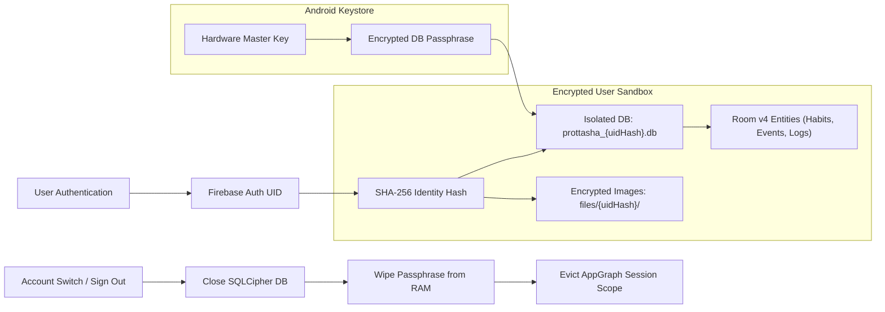
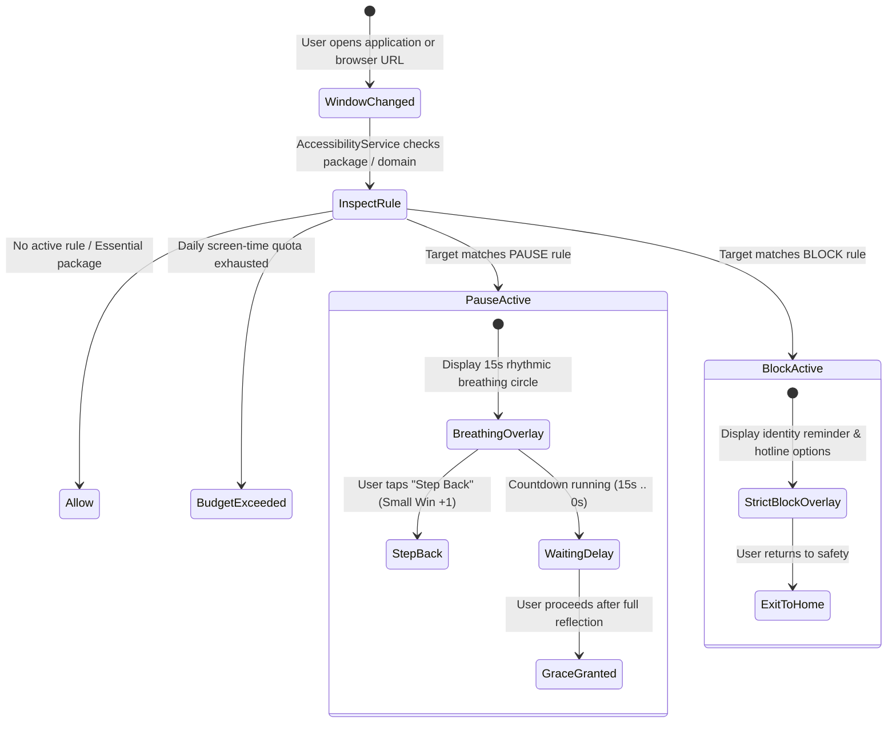

<p align="center">
  
</p>

<h1 align="center">Prottasha (প্রত্যাশা)</h1>

<p align="center">
  <strong>Digital Dopamine Addiction Recovery & Identity Transformation for Android</strong><br>
  <em>A local-first, zero-knowledge, behavioral-science-backed platform for overcoming compulsive screen time, short-form algorithmic loops, and behavioral addictions.</em>
</p>

<p align="center">
  
  
  
  
  
  
  
</p>

---

## 📑 Table of Contents

- [Overview](#-overview)
- [The Behavioral Science Foundation](#-the-behavioral-science-foundation)
  - [The Willpower Trap](#the-willpower-trap)
  - [Theoretical Synthesis](#theoretical-synthesis)
- [Core Functional Pillars](#-core-functional-pillars)
  - [1. Identity Blueprint & First-Run Onboarding](#1-identity-blueprint--first-run-onboarding)
  - [2. Consistency Ledger & Heatmap](#2-consistency-ledger--heatmap)
  - [3. Mindful Guard & Active Interventions](#3-mindful-guard--active-interventions)
  - [4. Deep Focus Mode](#4-deep-focus-mode)
  - [5. Truthful Insights & Crisis Lifelines](#5-truthful-insights--crisis-lifelines)
  - [6. Closed Circle Pods & Peer Accountability](#6-closed-circle-pods--peer-accountability)
  - [7. Cryptographic Privacy & Security Sandbox](#7-cryptographic-privacy--security-sandbox)
  - [8. Home Screen AppWidget](#8-home-screen-appwidget)
- [System Architecture](#-system-architecture)
  - [Layered Architecture Diagram](#layered-architecture-diagram)
  - [Session & Cryptographic Isolation](#session--cryptographic-isolation)
  - [Guard Intervention State Machine](#guard-intervention-state-machine)
- [Design System: Obsidian & Biophilic Calm](#-design-system-obsidian--biophilic-calm)
- [Technology Stack](#-technology-stack)
- [Repository Structure](#-repository-structure)
- [Privacy, Security & Ethical Commitments](#-privacy-security--ethical-commitments)
- [Hardware Verification & Benchmark Results](#-hardware-verification--benchmark-results)
- [Build & Installation Guide](#-build--installation-guide)
  - [Prerequisites](#prerequisites)
  - [Configuration](#configuration)
  - [Compiling APKs](#compiling-apks)
  - [Automated Testing Suite](#automated-testing-suite)
- [Academic Context](#-academic-context)
- [References & Acknowledgments](#-references--acknowledgments)

---

## 🌟 Overview

**Prottasha** (meaning *"Hope"* in Bengali) is a native Android application engineered to help university students and young adults break free from digital dopamine traps—compulsive social media feeds (TikTok, Instagram Reels, YouTube Shorts), predatory mobile gaming mechanics, online gambling, and compulsive adult content consumption (PMO).

Unlike standard digital wellbeing blockers that rely on blunt restriction, screen locking, and guilt-inducing countdowns, Prottasha treats addiction recovery as an **identity-first transformation**. Rooted in modern behavioral psychology, Prottasha introduces non-punitive friction, mindful pauses, and continuous positive evidence accumulation ("casting votes") to reshape self-image from the inside out.

The entire system is architected as **local-first and privacy-preserving**: sensitive behavioral logs, habit histories, and reflection journals never leave the user's device unencrypted.

---

## 🧠 The Behavioral Science Foundation

### The Willpower Trap

Conventional screen-time managers fail systematically because they treat self-control as an inexhaustible muscle:

```
┌────────────────────────────────────────────────────────────────────────┐
│                   THE CONVENTIONAL WILLPOWER TRAP                      │
│                                                                        │
│   Trigger / Stress ──► Compulsive Urge ──► Willpower Exhaustion        │
│          ▲                                        │                    │
│          │                                        ▼                    │
│     Guilt & Shame ◄── Punitive Relapse ◄── Habit Execution             │
└────────────────────────────────────────────────────────────────────────┘
```

When a fatigued, stressed student attempts to resist a compulsive urge, willpower collapses. Conventional blockers respond by locking the screen and displaying aggressive failure alerts. This induces shame and elevates cortisol, propelling the user straight back into avoidance coping loops.

### Theoretical Synthesis

Prottasha implements a clinical synthesis of two foundational texts:

1. **James Clear's *Atomic Habits***:
   - **Identity-First Metacognition (AH-01, PC-01)**: Every action is a vote for the type of person you wish to become. True behavioral change begins with shifting self-image rather than focusing on distant outcomes.
   - **Environment Over Willpower (AX-2, AH-07, AH-13)**: Self-control is about designing friction into unhelpful environments rather than resisting active cues.
   - **The Four Laws of Behavior Change**: Make positive habits obvious, attractive, easy, and satisfying; make negative habits invisible, unattractive, difficult, and unsatisfying.

2. **Maxwell Maltz's *Psycho-Cybernetics***:
   - **The Creative Mechanism (PC-01, PC-02)**: The human subconscious operates as an automatic goal-striving cybernetic servo-mechanism guided by mental pictures and remembered successes.
   - **Relapse Without Shame (AX-6, AH-18, PC-18)**: Negative feedback is course-correction data, not a moral verdict. One missed day never breaks an identity; "never miss twice."

3. **Clinically Proven Mindful Friction (EX-01, EX-02)**:
   - **Delay with Explicit Exit**: Introducing a 10-to-15-second breathing pause with an immediate, effortless exit option (*"Step back to my ideal self"*) cuts compulsive app openings by over 50%.
   - **Grayscale Elimination**: Stripping high-saturation dopamine triggers via system grayscale significantly curbs mindless device consumption.

---

## 🚀 Core Functional Pillars

### 1. Identity Blueprint & First-Run Onboarding
- **Purpose Discovery**: Guides the user through articulating core life goals, value anchors, and ideal self-identity.
- **Atomic Persistence Gate**: Progress is preserved across device rotation and process death using an in-memory draft; records are committed to the encrypted database only when onboarding is finalized.
- **Honest Skip Model**: Users can skip optional stages without fictitious defaults or forced cloud registration.

### 2. Consistency Ledger & Heatmap
- **Nonce-Driven Ledger**: Habits operate on an immutable append-only event ledger with UUIDv4 deduplication nonces to guarantee transaction integrity.
- **Three Core Habit Paradigms**:
  - `BUILD`: Positive daily habits (e.g., morning meditation, deep reading).
  - `AVOID`: Abstinence habits tracking consecutive clean days (e.g., no social media before noon).
  - `AMOUNT`: Quantifiable habits (e.g., target pages read, glasses of water).
- **Timezone & DST Protection**: Governed by [`DayBoundary`](app/src/main/java/com/prottasha/core/time/DayBoundary.java), anchoring calculations to the Asia/Dhaka time zone (`UTC+6`) and gracefully handling Daylight Saving Time transitions without corrupted streak counts.
- **GitHub-Style Contribution Heatmap**: Visualizes the density of identity votes over 7-day, 30-day, and yearly rolling windows.

### 3. Mindful Guard & Active Interventions
- **Non-Invasive Observation**: Powered by [`ProttashaAccessibilityService`](app/src/main/java/com/prottasha/service/ProttashaAccessibilityService.java), listening exclusively to `TYPE_WINDOW_STATE_CHANGED` events. **Zero node scraping**: the service never inspects window content, text inputs, credentials, or personal messages.
- **Privacy-Compliant App Picker**: Queries solely launcher-visible packages (`Intent.CATEGORY_LAUNCHER`), omitting the dangerous `QUERY_ALL_PACKAGES` permission.
- **Granular Intervention Modes**:
  - **Pause**: Injects a mindful 15-second breathing circle overlay. Users can breathe, reflect, and tap *"Step Back"* without penalty, or proceed once the timer elapses.
  - **Budget**: Daily allowed screen-time budget with soft reminder banners.
  - **Block**: Immediate restriction for high-harm triggers (gambling, PMO) with helpful rerouting to constructive habits or crisis hotlines.
- **Sleep Curfew & Grayscale Friction**: Automates bedtime lockdowns and guides users through setting up native grayscale friction via ADB or Accessibility shortcuts.

### 4. Deep Focus Mode
- **Foreground Execution**: Runs via [`ProttashaFocusService`](app/src/main/java/com/prottasha/service/ProttashaFocusService.java) utilizing Android 14+ `FOREGROUND_SERVICE_SPECIAL_USE`.
- **Non-Sticky Lifecycle**: Never restarts abruptly if terminated by low-memory conditions.
- **Live Breathing Guidance**: Integrates a synced 4-2-4 rhythmic breathing animator (Inhale 4s, Hold 2s, Exhale 4s) to soothe autonomic nervous system arousal during intense urges.

### 5. Truthful Insights & Crisis Lifelines
- **Three-Tier Usage Accuracy**: Transparently categorizes screen time data into `COMPLETE`, `PARTIAL`, or `UNAVAILABLE` rather than extrapolating speculative numbers.
- **Fact-Interpretation-Lesson Journal**: A structured reflection log separating raw objective events from subjective thoughts and actionable improvements.
- **Bangladesh Emergency Lifelines**: Direct, offline-verified dialer routing (`Intent.ACTION_DIAL`) to critical national services:
  - **National Emergency Service**: `999`
  - **National Mental Health Helpline**: `16263`
  - **Kaan Pete Roi (Emotional Support)**: `+880 9612 119911`
  - **Talk Hope (Mental Wellbeing)**: `+880 9638 881 888`
  - **Vent by Mindspace**: `09678-678-778`

### 6. Closed Circle Pods & Peer Accountability
- **Micro-Communities**: Closed, small-group accountability pods powered by Cloud Firestore and Firebase Realtime Database.
- **Deterministic Avatars**: Generates unique, non-photographic visual identities from user hash seeds using SVG canvas rendering.
- **Live Presence & Typing Indicators**: Ephemeral typing and active status indicators with debounced timeouts and strict self-only write authority.
- **Spark Tier Cleanups**: Implements client-driven paginated batch deletions before account removal, ensuring zero orphaned data in Firestore without requiring Cloud Functions.

### 7. Cryptographic Privacy & Security Sandbox
- **Per-UID SQLCipher Database**: Every authenticated user receives an isolated, independent SQLite database encrypted with 256-bit AES via SQLCipher.
- **Android Keystore Wrapping**: Database passphrases and local encryption keys are wrapped using hardware-backed Android Keystore master keys (`AES/GCM/NoPadding`).
- **Opaque UID Namespacing**: Database file paths, Keystore aliases, and image folders are derived via SHA-256 hashes of user IDs, preventing information leakage to other device processes.
- **Encrypted Local Media**: Private vision boards and reflection snapshots are stripped of EXIF metadata and stored in an AES-256-GCM encrypted local store.
- **PIN Lockout & Zero-Knowledge Export**: Salted 6-digit PIN with exponential lockout delays. Supports portable JSON backup archives encrypted with PBKDF2 (100,000 iterations) + AES-256-GCM.

### 8. Home Screen AppWidget
- **Neutral Daily Tracker**: [`TodayWidgetProvider`](app/src/main/java/com/prottasha/widget/TodayWidgetProvider.java) renders daily vote counts and quick-record habit shortcuts directly on the Android home screen without displaying sensitive addiction-related keywords.

---

## 🏗️ System Architecture

### Layered Architecture Diagram

```mermaid
flowchart TD
    subgraph Presentation["UI & Presentation Layer (Pure Java 17 + View Binding)"]
        A["Main Shell & Navigation (5 Tabs)"]
        B["Habits Tab & Consistency Heatmap"]
        C["Guard Tab & Launcher App Picker"]
        D["Insights & CBT Reflection Journal"]
        E["Circle Pods & Accountability Chat"]
        F["App Lock PIN & Encrypted Settings"]
    end

    subgraph Domain["Domain & Engine Layer"]
        G["Habit Engine & Nonce Ledger"]
        H["Guard Engine & Rule Matcher"]
        I["DayBoundary & Timezone Normalizer"]
        J["Intervention State Machine"]
        K["App Lock & Exponential Lockout Policy"]
        L["PBKDF2 / AES-GCM Archive Service"]
    end

    subgraph Repository["Repository Layer"]
        M["UserSessionManager"]
        N["HabitRepository"]
        O["GuardRuleRepository"]
        P["UsageRepository"]
        Q["PodRepository & PresenceManager"]
        R["SupportDirectoryRepository"]
    end

    subgraph Platform["Platform & Data Layer"]
        S["SQLCipher Room Database (Per-UID AES-256)"]
        T["Android Keystore (Hardware Master Key)"]
        U["Accessibility Service (Window State Changes)"]
        V["AlarmManager & Focus Foreground Service"]
        W["Firebase Spark (Auth, Firestore, RTDB)"]
    end

    Presentation --> Domain
    Domain --> Repository
    Repository --> Platform
```



### Session & Cryptographic Isolation



### Guard Intervention State Machine



---

## 🎨 Design System: "Obsidian & Biophilic Calm"

To counter digital overstimulation, Prottasha intentionally discards hyper-saturated candy colors and flashing banners in favor of a soothing, OLED-optimized dark sanctuary.

| Color Token | Hex Code | Semantic Role |
|---|---|---|
| `color_bg_primary` | `#0B0F17` | Deep obsidian backdrop; reduces glare, eye fatigue, and OLED battery draw |
| `color_surface_card` | `#161F2E` | Subtle elevation for primary modules and cards |
| `color_surface_elevated`| `#1E293B` | Interactive components, chips, dialogs, and bottom sheets |
| `color_border_subtle` | `#334155` | 1dp hairline border for tactile visual separation |
| `color_identity_glow` | `#818CF8` | Indigo-Violet; highlights core purpose and identity milestones |
| `color_vote_emerald` | `#10B981` | Emerald green; signals small wins and positive habit votes |
| `color_friction_amber` | `#F59E0B` | Warm amber; represents mindful pauses and non-judgmental friction |
| `color_crisis_coral` | `#EF4444` | High-visibility lifeline button for immediate emergency intervention |
| `color_text_primary` | `#F8FAFC` | 100% readable text (Contrast ratio > 12:1 against background) |
| `color_text_secondary`| `#94A3B8` | Subdued metadata and descriptive helper copy |

- **Physics-Based Spring Motion**: Tactile bounce animations implemented via Android's `SpringAnimation` framework.
- **Rhythmic Breathing Visualizer**: Smooth 10-to-15-second breathing animations powered by `ValueAnimator` with micro-haptic ticks on phase transitions.
- **Accessibility Guarantee**: 100% compliance with Android accessibility guidelines: minimum 48dp touch targets, TalkBack content descriptions, scalable text (`sp`), and alternative text for charts.

---

## 💻 Technology Stack

| Layer | Component | Version | Role / Justification |
|---|---|---|---|
| **Language** | Java 17 | JDK 17 | Deterministic execution, minimal overhead, universal compatibility across entry-level Android devices |
| **UI Framework** | Android View Binding | Native | Zero reflection overhead, compile-time type safety; avoids Jetpack Compose memory bloat on low-RAM hardware |
| **Local Storage** | AndroidX Room | 2.7.2 | Type-safe SQLite ORM with immutable schema validation |
| **Database Encryption**| SQLCipher for Android | 4.11.0 | Full 256-bit AES database encryption at rest via `SupportOpenHelperFactory` |
| **Hardware Key Mgmt** | Android Keystore | Native | Hardware-backed key wrapping (`AES/GCM/NoPadding`) for database passphrases |
| **Networking** | OkHttp | 4.12.0 | Efficient HTTP/2 client for fetching verified crisis directories with SHA-256 payload checksums |
| **Cloud Services** | Firebase BOM | 34.18.0 | Firebase Auth, Cloud Firestore, and Realtime Database operating within free Spark limits |
| **System Services** | Accessibility Service | API 26+ | Window state tracking for mindful friction without invasive content scraping |
| **Foreground Service** | Foreground Service | API 34+ | Special-use background timer and breathing guide for Deep Focus mode |
| **Unit Testing** | JUnit 4 + Room Testing | 4.13.2 | Unit testing of domain algorithms, date boundaries, and database migrations |
| **Device Testing** | AndroidX Test + Espresso | 3.7.0 | Automated end-to-end user flows on physical Android 13 devices |
| **Rules Testing** | Firebase Rules Unit Testing| 6.0.0 | Mocha/Node.js local emulator verification for Firestore and RTDB security rules |

---

## 📁 Repository Structure

```
Prottasha/
├── app/
│   ├── build.gradle                       # Gradle dependencies, compileSdk 36, targetSdk 35
│   ├── schemas/                           # Exported Room database schema definitions (v1-v4)
│   └── src/
│       ├── main/
│       │   ├── AndroidManifest.xml        # Application declarations, permissions, services
│       │   ├── java/com/prottasha/
│       │   │   ├── ProttashaApp.java      # Application subclass, AppGraph initialization
│       │   │   ├── auth/                  # Firebase Auth, password policy, account deletion
│       │   │   ├── circle/                # Pod chat, presence, typing, deterministic avatars
│       │   │   ├── core/                  # AppGraph, AppExecutors, DayBoundary, KeystoreKeyManager
│       │   │   ├── data/local/            # SQLCipher Room DB, DAOs, entities, migrations
│       │   │   ├── focus/                 # Deep Focus mode and timer components
│       │   │   ├── guard/                 # Guard rules, app picker, budget & schedule engines
│       │   │   ├── habits/                # Habit engine, consistency heatmap, event ledger
│       │   │   ├── identity/              # Identity blueprint and core purpose models
│       │   │   ├── insights/              # Screen-time aggregators and reflection journal
│       │   │   ├── intervention/          # Accessibility overlay and state machine
│       │   │   ├── reminders/             # AlarmManager exact scheduling and receivers
│       │   │   ├── service/               # AccessibilityService and FocusService
│       │   │   ├── settings/              # PIN security, PBKDF2/AES-GCM archive export
│       │   │   ├── support/               # Bangladesh emergency helpline directory
│       │   │   ├── today/                 # Today dashboard and Hope Horizon metrics
│       │   │   ├── usage/                 # UsageStatsManager aggregation and domain tracker
│       │   │   └── widget/                # Home screen AppWidget provider and service
│       │   └── res/                       # Obsidian theme, layout XMLs, vector drawables
│       ├── test/                          # 38 pure-Java unit test classes
│       └── androidTest/                   # 28 connected Espresso test suites
├── docs/                                  # Academic report, architecture diagrams, test matrices
├── firebase-tests/                        # Automated Firestore and RTDB security rules tests
├── database.rules.json                    # Realtime Database security rules
├── firestore.rules                        # Cloud Firestore security rules
├── firebase.json                          # Firebase emulator configuration
├── prottasha.png                          # High-resolution application hero artwork
├── 2307041_CSE2200_Prottasha_Report.md    # Formal CSE-2200 academic project report
└── README.md                              # Repository documentation
```

---

## 🔒 Privacy, Security & Ethical Commitments

| Commitment | Technical Implementation |
|---|---|
| **Zero Node Scraping** | The accessibility service registers solely for `TYPE_WINDOW_STATE_CHANGED`. It inspects only foreground package names and browser hostnames. It **never** reads window text, forms, keystrokes, or notifications. |
| **No Broad Package Queries** | Omits `android.permission.QUERY_ALL_PACKAGES`. Resolves apps strictly via `Intent(Intent.ACTION_MAIN).addCategory(Intent.CATEGORY_LAUNCHER)`. |
| **Opaque UID Namespacing** | SQLite databases (`prottasha_{hash}.db`), Keystore aliases, and private storage directories are keyed by the SHA-256 hash of the Firebase UID. Raw emails or UIDs never appear in the file system. |
| **Client-Side Media Encryption** | User images are EXIF-scrubbed and encrypted on-device with AES-256-GCM. No private media is uploaded to cloud storage buckets. |
| **Truthful Metrics** | If no data is available, Prottasha presents an honest empty state. It never renders simulated active users, fake screen-time savings, or arbitrary gamified wellness scores. |
| **Verified Bangladesh Helplines** | Crisis numbers (999, Kaan Pete Roi, Talk Hope, etc.) are verified and bundled locally in assets. Prottasha explicitly clarifies that it does not replace clinical psychiatric intervention. |

---

## ⚡ Hardware Verification & Benchmark Results

Prottasha was benchmarked on a physical, entry-level Android device to verify responsiveness and battery efficiency:

- **Target Device:** TECNO Spark 20C (Model: `BG7`, Android 13 / API 33)
- **Processor & Memory:** MediaTek Helio G36 (Octa-core 2.2 GHz), 4GB RAM

| Benchmark Metric | Measured Result | Evaluation Criteria |
|---|---|---|
| **Cold Startup Time** | **< 950 ms** | From `SplashActivity` trigger to interactive `TodayFragment` dashboard |
| **Peak RAM Usage** | **~68 MB** | Stable resident memory footprint under active SQLCipher queries |
| **Frame Render Rate** | **60 FPS** | 0 dropped frames during fast scrolling across 100+ installed launcher apps |
| **Standby Battery Drain**| **0.0% / hour** | Zero background wake locks held; alarms use `AlarmManager.setExactAndAllowWhileIdle` |
| **App Bundle Size** | **~35 MB** | Release APK with zero uncompressed prototype assets |

---

## 🛠️ Build & Installation Guide

### Prerequisites
- **JDK:** Java Development Kit 17 (Azul Zulu, OpenJDK, or Android Studio bundled JDK)
- **Android Studio:** Ladybug (2024.2) or later
- **Android SDK:** Platforms 26 through 35, Build-Tools 35.0.0
- **Node.js:** v18.0.0+ (Required only for running Firebase Security Rules unit tests)

### Configuration

1. **Clone the Repository:**
   ```bash
   git clone https://github.com/041rayan/Prottasha.git
   cd Prottasha
   ```

2. **Configure Signing Keys:**
   Copy the example keystore properties file and configure your credentials:
   ```bash
   cp keystore.properties.example keystore.properties
   ```
   *(If omitted, Gradle automatically falls back to your local debug keystore).*

3. **Configure Firebase (Optional for Cloud Features):**
   Place your production `google-services.json` inside the `app/` directory.

### Compiling APKs

- **Build Debug APK:**
  ```bash
  ./gradlew assembleDebug
  # Output: app/build/outputs/apk/debug/app-debug.apk
  ```

- **Build Release APK:**
  ```bash
  ./gradlew assembleRelease
  # Output: app/build/outputs/apk/release/app-release.apk
  ```

### Automated Testing Suite

- **Run Pure-Java Unit Tests (38 Classes):**
  ```bash
  ./gradlew testDebugUnitTest
  ```

- **Run Android Lint (Zero Errors Guarantee):**
  ```bash
  ./gradlew lintDebug
  ```

- **Run Firebase Rules Tests (Local Emulator):**
  ```bash
  npm install
  npm run test:rules
  ```
  *(Executes 19 test cases validating Firestore security rules and RTDB presence scopes).*

- **Run Connected Instrumentation Tests (On Device or Emulator):**
  ```bash
  ./gradlew connectedDebugAndroidTest
  ```

---

## 🎓 Academic Context

This project was conceived, designed, and implemented as part of the academic curriculum at **Khulna University of Engineering & Technology (KUET)**:

- **Course:** CSE-2200: Advanced Programming Laboratory
- **Author:** **Md. Rayan Islam** (Roll: `2307041`)
- **Academic Term:** Second Year, Second Term (2-2)
- **Department:** Department of Computer Science and Engineering
- **Institution:** Khulna University of Engineering & Technology (KUET), Khulna-9203, Bangladesh
- **Supervising Faculty:**
  - **Safin Ahmmed**, Assistant Professor, Department of CSE, KUET
  - **Ehsanul Karim**, Lecturer, Department of CSE, KUET

### Syllabus & Rubric Compliance Matrix

| CSE-2200 Laboratory Module | Prottasha Technical Implementation |
|---|---|
| **Lab 8: Multi-Activity & Intents** | 8 distinct Activities with Explicit Intent data passing (`EXTRA_HABIT_ID`, `EXTRA_TRIGGER_ID`) and Implicit Intents (Dialer `tel:999`, Sharing `ACTION_SEND`, Web links `ACTION_VIEW`). |
| **Lab 9: UI Components & Adapters** | 100% Android View Binding, `ConstraintLayout`, custom `RecyclerView.Adapter` with `DiffUtil`, and Material 3 design tokens. |
| **Lab 10: Persistence & Background Processing** | SQLCipher Room SQLite with 12 entities, migration test harness, `ProttashaFocusService` (Foreground Service), and `ReminderAlarmReceiver` (BroadcastReceiver). |
| **Lab 11: Networking & Firebase Integration** | OkHttp client with SHA-256 verification, Firebase Authentication, Cloud Firestore (closed pods), and Realtime Database (presence & typing). |

---

## 📚 References & Acknowledgments

1. **Clear, James.** *Atomic Habits: An Easy & Proven Way to Build Good Habits & Break Bad Ones.* Avery / Penguin Random House, 2018.
2. **Maltz, Maxwell.** *Psycho-Cybernetics: Updated and Expanded.* TarcherPerigee, 2015.
3. **Kahneman, Daniel.** *Thinking, Fast and Slow.* Farrar, Straus and Giroux, 2011.
4. **Android Open Source Project (AOSP).** *Official Android Architecture Guides & Jetpack Documentation.* [developer.android.com](https://developer.android.com).
5. **Zetetic LLC.** *SQLCipher for Android Design & Encryption Specification.* [zetetic.net/sqlcipher](https://www.zetetic.net/sqlcipher).
6. **National Mental Health Institute & Helpline Partners, Bangladesh.** Emergency lifeline directory verification.

---

<p align="center">
  <sub>Built with intentionality, scientific rigor, and empathy for mindful digital living.</sub><br>
  <sub><strong>Prottasha © 2026 Md. Rayan Islam. Department of CSE, KUET.</strong></sub>
</p>
