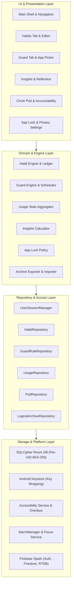
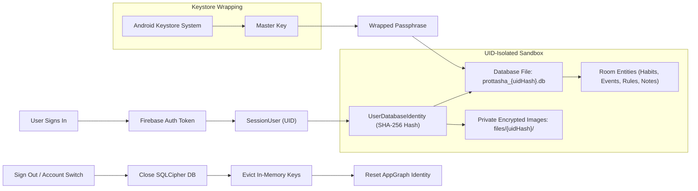
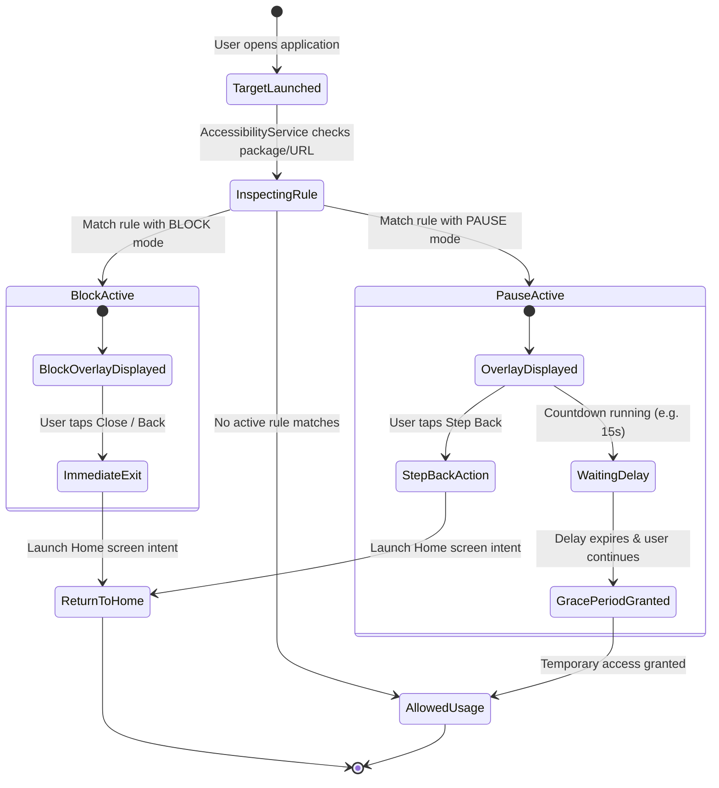
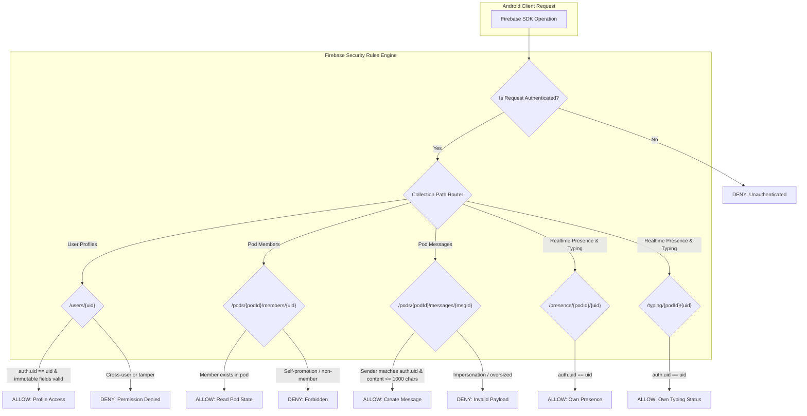

# Prottasha Architecture, Session, Intervention, and Security Diagrams

This document contains architectural diagrams documenting the security model, intervention state machine, and cloud rules.

---

## 1. High-Level Architecture Overview

---

## 2. Session Ownership and Cryptographic Isolation

---

## 3. Guard Intervention State Machine

---

## 4. Firebase Cloud Security & Authority Rules

